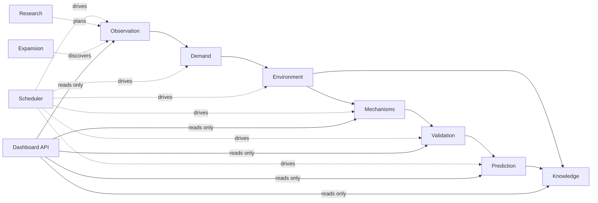
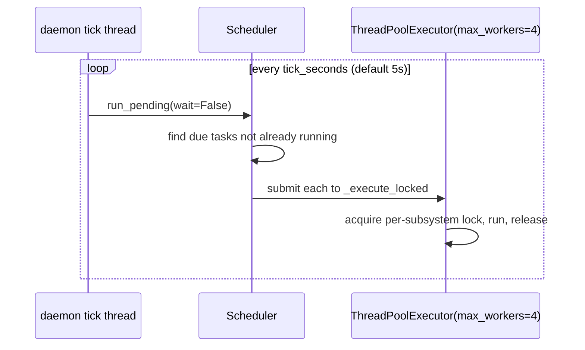

# 02 — Complete Architecture

*Verified: `elecous/bootstrap.py`, `elecous/scheduler/registration.py`,
`elecous/governance/constitution.py`, `elecous/common/vocabulary.py`.*

## Governing philosophy

Three hard rules enforced in code, not convention (`governance/constitution.py`):

1. `require_real_provenance` — every observation must carry a real
   source_id + access_method + URL. No synthetic data, ever.
2. `require_validated_promotion` — no lifecycle stage skips; no promotion
   without a PASSED validation status.
3. `require_no_future_leakage` — historical replay can never see data
   postdating the instant being replayed.

## Dependency order (`bootstrap.py::build_stack`)



Each engine is constructed once in this order inside `build_stack()`; every
engine registers its own DuckDB migrations on first touch
(`storage/database.py::Migration`, idempotent additive).

## Startup sequence (verified: `scripts/cli.py::cmd_run`, `dashboard/api/app.py::main`)

Both entry points do the same three things:
```
build_stack()                        # construct all engines, open all DBs
register_all_schedules(stack)        # register 38 scheduled tasks
stack.scheduler.start()              # spawn the daemon tick thread
[uvicorn.run(app) for the dashboard] # serve the API + frontend
```
**Critical fact**: before this session, only `elecous run` called
`register_all_schedules` — `python -m elecous.dashboard.api.app` served a
passive viewer that never ran real work. Fixed; both entry points are now
live instances.

## Scheduler flow (`scheduler/scheduler.py`)


Concurrency model (added this session): different subsystems run in parallel;
tasks *within* one subsystem serialize via a per-subsystem `threading.Lock`,
so a long network-bound task (real GDELT sweep ≈30 politeness-bound minutes)
never blocks the other 37 tasks. `run_pending(wait=True)` (the historical
synchronous contract, used by tests/scripts) blocks until the dispatched batch
finishes; `wait=False` (used by the live tick loop) does not.

## Prediction pipeline (see 09_PREDICTION_PIPELINE-equivalent in docs/manual/09)

```
observation (real, provenance-checked)
  → z-score/trend/level signal (environment/signal_discovery/extractor.py)
  → episode (demand/spikes/detector.py, 2-signal corroboration required)
  → factor (environment/factor_discovery/, co-occurrence pattern mining)
  → mechanism (mechanisms/engine.py, factor combination + behavioural chain)
  → validated (validation/engine.py — 6 checks + confidence floor, AND-ed)
  → world match (prediction/world_matching/matching.py, phenomenon-level
    activation ≥ thresholds.yaml prediction.match_threshold)
  → opportunity + prediction row
  → prospective registration (validation/prospective/prospective.py)
  → resolve_due() after lead-time horizon (prediction/engine.py)
  → confidence update + knowledge-graph sync
```

## Validation flow

`validation/engine.py` is the **only** engine allowed to call `promote()`
(spec 6.30) — Demand/Environment/Mechanism engines only ever produce
candidates. Six checks gate mechanism promotion: `generalizes`, `repeatable`,
`timing_stable`, `skeptic_survives`, `historical_precision_ok`,
`survives_competing_explanations` — ALL must pass, AND confidence must clear
a rising floor per lifecycle stage. Historical validation promotes at most to
VALIDATED; TRUSTED requires real prospective (future) confirmation only.

## Database flow

One DuckDB file per domain (`storage/database.py::DatabaseManager`), **single
writer** — this is the most important operational constraint (see
08_RUNNING_ELECOUS.md). RLock-wrapped per connection. 15 files register
migrations (full list in `docs/manual/02_REPOSITORY_STRUCTURE.md`).

## Dashboard flow

Single-file vanilla-JS frontend (`dashboard/frontend/index.html`) polling a
FastAPI backend (`dashboard/api/routes.py`, 32 routes, zero scientific
reasoning — routes only serialize what engines already produced). Silent
15-second refresh, no full reload. See `docs/manual/11_DASHBOARD_REFERENCE.md`
for the view list.

## What is NOT yet built (confirm before assuming)

- No message queue / distributed workers — the scheduler is one process,
  one machine, threading-based concurrency only.
- No knowledge-graph visualization (data model exists in
  `knowledge/graph/graph.py`; no interactive UI).
- No per-product dedicated intelligence pages (data exists via
  `/api/mechanisms`, `/api/factors`, `/api/episodes`; no composed product view).
