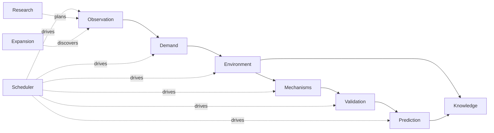

# 03 — System Architecture

**Scope**: Mermaid diagrams matching the implementation. **Read to complete**:
`elecous/bootstrap.py` (dependency order → overall diagram + startup),
`elecous/scheduler/registration.py` (scheduler flow, all 38 tasks),
`elecous/prediction/engine.py` (prediction pipeline),
`elecous/knowledge/graph/graph.py` (knowledge graph nodes/edges),
`elecous/observation/network.py` (observation flow),
`elecous/validation/engine.py` (validation flow),
`elecous/expansion/{source_discovery,connector_evolution}.py` (discovery + connector lifecycle).

Verified anchor — the legal dependency order (from `bootstrap.py` build order):
Internet → Observation → Demand → Environment → Mechanisms → Validation →
Knowledge → Prediction → Dashboard, with Research/Expansion/Scheduler/Supervisor
layered on top.

